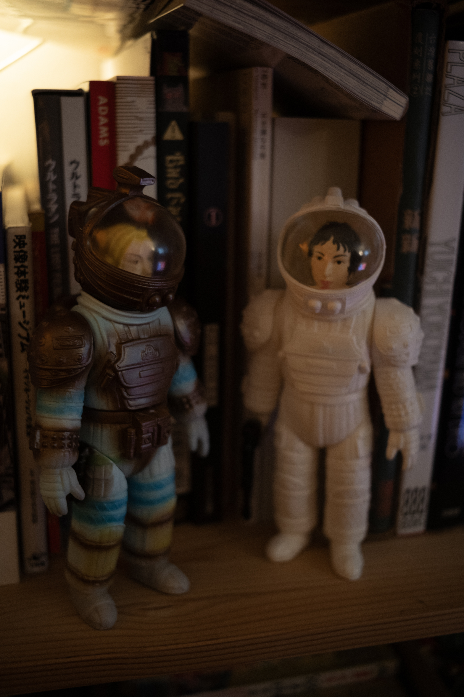
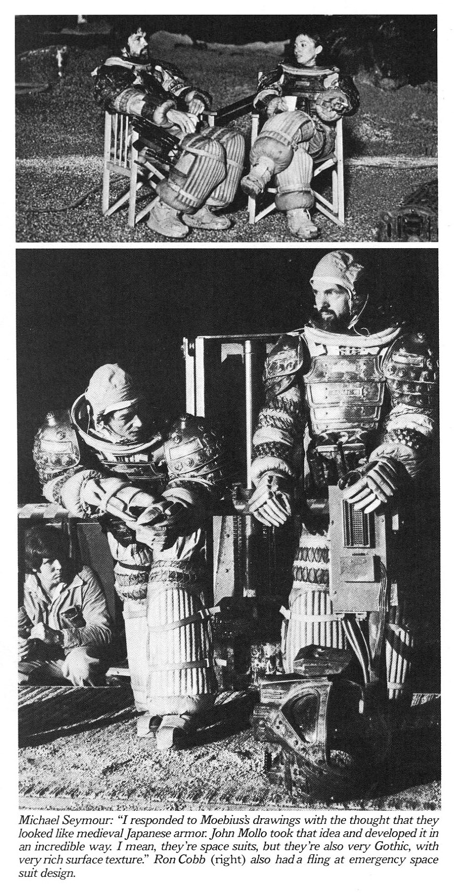

今天這個小部落格正式開張了。這裡會用中文和英文記錄我們喜歡的東西。

<!-- English -->

Today this little blog officially opens. We will write about the things we love, in both Chinese and English.

<!-- row -->

<!-- row -->

文章用 Markdown 寫，段落之間空一行就好。每一「列」用 `row` 標記隔開：有 `English` 標記的列會左右對照，沒有的列（例如上面那張圖）會橫跨兩欄。

<!-- English -->

Posts are written in Markdown — just leave a blank line between paragraphs. Each "row" is separated by a `row` marker: rows with an `English` marker are shown side by side, and rows without one (like the picture above) span both columns.

<!-- row -->

<!-- row -->

最後一段中文。圖片下面可以繼續接下一段對照文字。

<!-- English -->

The last English paragraph. You can keep adding paired text after a picture.
